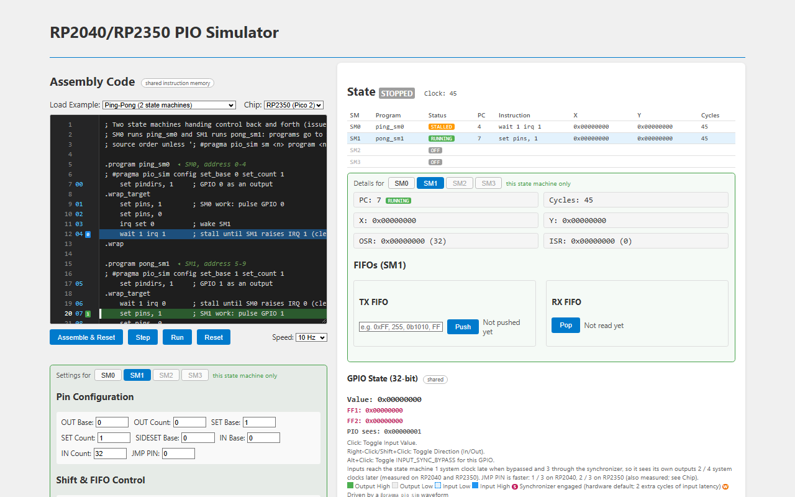

# PIO Simulator



A browser-based PIO (Programmable I/O) assembly simulator for the Raspberry Pi Pico (RP2040) and Pico 2 (RP2350).

## Features

- **No Installation Required:** Write and simulate PIO assembly code completely within your web browser.
- **RP2040 & RP2350 Support:** Compatible with both the original Pico and the new Pico 2 architectures.
- **Real-time Visualization:** 
  - Step-by-step execution debugging
  - Scratch registers (X, Y) and Shift registers (ISR, OSR) states
  - TX / RX FIFO buffers
  - GPIO pin states and timing charts
- **Interrupts (IRQ) Monitoring:** Clickable IRQ flags to test wait and set behaviors interactively.
- **Simulator pragmas:** Pin waveforms, IRQ events and settings declared in the source (see below).

## Usage

You can use the live version hosted here:
**[Launch PIO Simulator](https://ice458.github.io/tools/pio_sim/)**

1. Paste or write your PIO assembly code in the editor on the left.
2. Use the control buttons (Run, Step, Reset) to execute the code.
3. Monitor the changes in state machines, FIFOs, and timing diagrams on the right.

## How closely it follows the hardware

The emulator follows the PIO chapters of the RP2040 and RP2350 datasheets, and the assembler follows `pioasm` from the pico-sdk. Cycle timing has also been compared with a real RP2040 and RP2350 (a per-cycle pin trace and the final state of about 30 test programs, captured on the chip); where the hardware and the datasheet disagree, the simulator follows the hardware.

- **Settings start at the hardware reset values.** In particular OUT Count is 0, so `out pins` writes nothing until you set it, as on a real chip before the C setup code runs. Set the controls the way your `sm_config_*` calls would, or put the settings in the source with `.in` / `.out` / `.set` / `.fifo` / `.mov_status` or a `config` pragma.
- **Input latency.** A pin reaches the state machine 1 system clock late when its synchronizer is bypassed and 3 through the 2-flipflop synchronizer (the reset default). A state machine sees its own outputs 2 / 4 system clocks later, the same on RP2040 and RP2350.
- **Clock divider.** One step is one state machine cycle. With a divider (the "Clock div" control, `.clock_div`, or `config clkdiv`), the input path still runs on the system clock, so input latency counted in state machine cycles gets shorter: at 2 the program sees its own output 1 / 2 cycles later, at 4 and above 1 / 1. Fractional dividers spread the extra clocks with a running total, as the hardware does.
- **Pin writes.** OUT and MOV write OUT Count pins, SET writes SET Count pins, and a side-set wins over an OUT/SET to the same pin on the same cycle.
- **Assembler.** Expressions, `.define`, `public`, labels, `//` and `/* */` comments, `% c-sdk { ... %}` blocks, `.word`, `.origin`, `.pio_version`, and the same range checks as `pioasm`. RP2350-only features (`mov pindirs`, `wait jmppin`, `irq prev/next`, `mov rxfifo[]`) are rejected under `.pio_version 0`.
- **EXEC.** `out exec` / `mov exec` run the instruction on the next cycle after the EXEC instruction's own delay. The datasheet says that delay is ignored, but on both chips it is not.
- **Also supported:** FIFO joining and the RP2350 put/get FIFO modes, `mov x, status` on an IRQ flag.

## Simulator pragmas

Comment lines starting with `; #pragma pio_sim` set up the simulation from the source. `pioasm` treats them as ordinary comments, so the same file still assembles for real hardware and the setup is saved with the code. Clocks are PIO clock cycles counted from reset. Numbers may be `.define` names. A pragma must be on a comment line of its own; a second `;` starts a normal comment.

### Pin waveform

Drive an input pin with a test waveform.

```
; #pragma pio_sim pin 5 hi 3 low 7                 ; high 3 clocks, low 7, repeats forever
; #pragma pio_sim pin 4 low 9 hi 1 count 5         ; repeats 5 times, then stays high
; #pragma pio_sim pin 3 hi delay 12 low 2 hi 2     ; holds high for 12 clocks first
```

Syntax: `pin <n> [<hi|low> delay <clocks>] <hi|low> <clocks> ... [count <n>]`

- The `<hi|low> <clocks>` pairs form one period. It repeats forever, or `count` times, after which the pin holds its last level.
- An optional leading `<hi|low> delay <clocks>` holds a level once before the first period.
- A stimulated pin is marked `W` in the GPIO panel and added to the timing chart. Manual toggling has no effect on it, and the waveform is ignored while the pin is set as an output.

### IRQ event

Raise or clear an IRQ flag at given clocks, the way another state machine's `irq set` / `irq clear` would. This lets you test one half of a multi-state-machine handshake.

```
; #pragma pio_sim irq set 5 delay 4 repeat 12      ; raised at clock 4, 16, 28, ...
; #pragma pio_sim irq clear 5 delay 8 repeat 12    ; cleared at clock 8, 20, 32, ...
; #pragma pio_sim irq set 0 delay 20               ; raised once, at clock 20
```

Syntax: `irq set|clear <n> [delay <clocks>] [repeat <clocks>] [count <n>]`

- The first event is at clock `delay` (default 0). With `repeat` it recurs every that many clocks, forever or `count` times.
- The instruction executed on that clock already sees the new flag value. A real partner state machine is seen one cycle after it executes `irq`, so a partner instruction on cycle N corresponds to `delay N+1`.
- The program can still set and clear the flag itself, and so can you by clicking it. Scheduled flags are added to the timing chart.

### Settings

Load the settings controls on Assemble, so the pin mapping travels with the source.

```
; #pragma pio_sim config out_base 0 out_count 2 set_base 0 sideset_base 4
; #pragma pio_sim config in_base 0 jmp_pin 5 autopull on pull_thresh 8
```

Syntax: `config <name> <value> [<name> <value> ...]`

| Name | Value |
|---|---|
| `out_base`, `set_base`, `sideset_base`, `in_base`, `jmp_pin` | 0-31 |
| `out_count` | 0-32 |
| `set_count` | 0-5 |
| `in_count` | 1-32 |
| `in_shift`, `out_shift` | `left`, `right` |
| `autopush`, `autopull` | `on`, `off` |
| `push_thresh`, `pull_thresh` | 1-32 |
| `status_sel` | `tx`, `rx`, `irq` |
| `status_n` | 0-31 |
| `fifo` | `txrx`, `tx`, `rx`, `txput`, `txget`, `putget` |
| `clkdiv` | 1-65535, fractions such as `2.5` allowed (1/256 steps) |

Settings the source does not name keep whatever the controls show. A `config` pragma overrides a directive (`.out`, `.in`, ...) that sets the same thing.

## Limitations

- One state machine only (it runs as SM0, so the IRQ `rel` flag adds 0). A source with more than one `.program` block is rejected. IRQ event pragmas can stand in for a partner state machine.
- `OUT_STICKY` / `INLINE_OUT_EN`, GPIOs above 31 (`GPIOBASE`), system-level interrupts and DMA are not modelled.
- The program is always loaded at address 0. `.origin` is accepted.
- Instructions are accepted without a `.program` line, which `pioasm` would reject.

## License

This project is licensed under the MIT License - see the [LICENSE](LICENSE) file for details.
